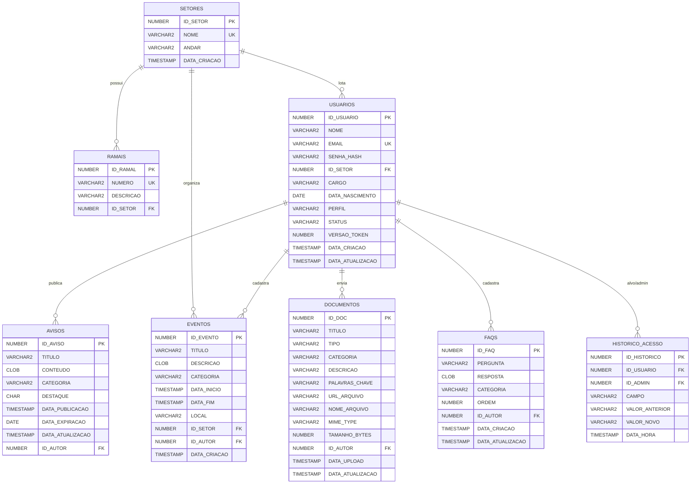

# Documentação do Banco de Dados — Intranet Hospitalar Decós (MVP)

Banco de dados relacional em **Oracle Database 23ai Free** (`FREEPDB1`, schema `DECOS`).

---

## 1. Diagrama Entidade-Relacionamento (ER)



---

## 2. Resumo das Tabelas e Views

| Objeto | Tipo | Descrição |
|---|---|---|
| `SETORES` | Tabela | Armazena os setores hospitalares (ex.: UTI, Pronto-Socorro, Farmácia) e o respectivo andar de localização. |
| `RAMAIS` | Tabela | Armazena um ou mais ramais telefônicos vinculados a cada setor, garantindo unicidade numérica entre setores (UC08). |
| `USUARIOS` | Tabela | Cadastro de colaboradores e credenciais com controle de perfil (`ADMIN`, `COLABORADOR`, `RH`, `MARKETING`), status (`ATIVO`/`INATIVO`) e versão de token para invalidação imediata de sessão (UC01, UC02, UC03). |
| `HISTORICO_ACESSO` | Tabela | Trilha de auditoria que registra toda alteração de `PERFIL` ou `STATUS` de um usuário, com data/hora e administrador responsável (UC03). |
| `AVISOS` | Tabela | Mural de comunicados, notícias, promoções e mudanças de setor, com suporte a destaque no topo e data de expiração (UC04, UC05). |
| `EVENTOS` | Tabela | Agenda de treinamentos, ações internas e eventos institucionais com data/hora de início e fim, local e setor organizador (UC12). |
| `DOCUMENTOS` | Tabela | Metadados e referência de armazenamento dos Procedimentos Operacionais Padrão (`POP`) e documentos institucionais (`DOCUMENTO`) em PDF/DOCX (UC06, UC07). |
| `FAQS` | Tabela | Perguntas e respostas frequentes organizadas por categoria e ordem de exibição (UC09). |
| `VW_DIRETORIO` | View | Visão consolidada de colaboradores ativos com setor, andar e ramais concatenados via `LISTAGG` para consulta rápida no diretório (UC10). |

---

## 3. Consultas de Verificação

Após subir o banco com `docker compose up -d`:

```sql
-- 1. Consultar o diretório de colaboradores ativos com setor e ramais
SELECT * FROM VW_DIRETORIO;

-- 2. Consultar apenas avisos vigentes (sem data de expiração ou não expirados)
SELECT * FROM AVISOS WHERE DATA_EXPIRACAO IS NULL OR DATA_EXPIRACAO >= TRUNC(SYSDATE);
```

## 4. Extras da Semana 5 (`database/init/04_ddl_extras.sql`)

O script roda sobre o banco do MVP sem apagar dados. Em bancos já criados (o `init` só executa na 1ª subida do container):

```bash
docker exec -i intranet-decos-oracle sqlplus -s decos/decos123@FREEPDB1 < database/init/04_ddl_extras.sql
```

| Objeto | Para que serve |
|---|---|
| `AVISOS.PRIORIDADE` (`NORMAL`/`URGENTE`) | carrossel e destaque de avisos urgentes |
| `DOCUMENTOS.CODIGO`, `JUSTIFICATIVA`, `RESUMO`, `STATUS_INDEXACAO` | código do POP, motivo da nova versão, resumo e situação da indexação (`PENDENTE`, `PROCESSANDO`, `INDEXADO`, `ERRO`, `SEM_TEXTO`). A versão vigente continua sendo `ATIVO = 'S'` (versionamento por tipo + título, já existente) |
| `DOCUMENTO_TRECHOS` | trechos de ~1.000 caracteres com `EMBEDDING VECTOR(384, FLOAT32)` — base de conhecimento do RAG |
| `RECONHECIMENTOS` | reconhecimentos publicados pelo RH/Admin |
| `INDICACOES_RECONHECIMENTO` | indicações de colegas (`PENDENTE`/`APROVADA`/`RECUSADA`); `CK_INDIC_PROPRIA` impede autoindicação |
| `NOTIFICACOES` | uma linha por publicação; `UQ_NOTIF_REFERENCIA (TIPO, ID_REFERENCIA, DATA_REFERENCIA)` impede duplicidade |
| `NOTIFICACOES_LIDAS` | estado de leitura por usuário |
| `LOG_IA` | log do assistente (usado a partir da Semana 6) |

As tabelas do Google Agenda (`INTEGRACOES_GOOGLE`, `EVENTOS_GOOGLE`) continuam em `migrations_google_agenda.sql`.

Busca vetorial (dimensão = modelo de embedding, 384):

```sql
SELECT ID_TRECHO FROM DOCUMENTO_TRECHOS
 ORDER BY VECTOR_DISTANCE(EMBEDDING, :v, COSINE) FETCH FIRST 5 ROWS ONLY;
```

Validação de constraints: inserir duas vezes a mesma `(TIPO, ID_REFERENCIA, DATA_REFERENCIA)` em `NOTIFICACOES` retorna `ORA-00001`.
