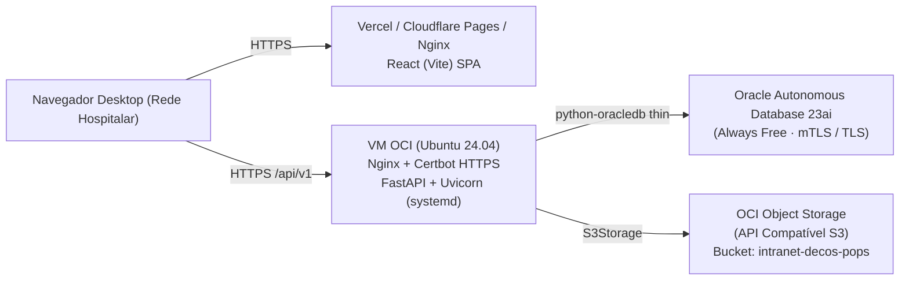

# Guia de Provisionamento e Deploy em Nuvem — Intranet Hospitalar Decós (S3-T3 / Semana 4)

> Documento de preparação da infraestrutura na **Oracle Cloud Infrastructure (OCI — Always Free)** para o deploy do MVP da Intranet Hospitalar Decós na Semana 4.

---

## 1. Visão Geral da Arquitetura em Nuvem



---

## 2. Provisionamento do Oracle Autonomous Database (Always Free)

1. No console da OCI, acesse **Oracle Database → Autonomous Database → Create Autonomous Database**.
2. Configure:
   - **Workload Type:** Transaction Processing (ATP)
   - **Deployment Type:** Serverless
   - **Always Free:** Habilitado (`23ai`)
   - **Database Name:** `DECOSPDB`
   - **Credencial ADMIN:** defina uma senha forte para o usuário `ADMIN`.
   - **Network Access:** selecione *Secure access from allowed IPs and VCNs* (adicione o IP público da VM do back-end) ou habilite TLS sem Wallet (*Require mutual TLS (mTLS) authentication = Off*) para conexão direta via `python-oracledb` em modo *thin*.
3. Crie o usuário e schema da aplicação (`DECOS`):
   ```sql
   CREATE USER DECOS IDENTIFIED BY "<SENHA_FORTE_PRODUCAO>" QUOTA UNLIMITED ON DATA;
   GRANT CONNECT, RESOURCE, CREATE VIEW TO DECOS;
   ```
4. Execute os scripts do repositório na ordem:
   - `database/init/01_ddl_mvp.sql`
   - `database/init/02_indices_views.sql`
   - `database/init/03_seed_base.sql`

---

## 3. Provisionamento do Bucket Object Storage (Compatível S3) para POPs

1. No console da OCI, acesse **Storage → Buckets → Create Bucket**:
   - **Bucket Name:** `intranet-decos-pops`
   - **Storage Tier:** Standard
   - **Visibilidade:** **Private** (todo acesso ocorre de forma autenticada pelo back-end via `StorageService`).
2. Gere uma **Customer Secret Key** para a API compatível com S3:
   - Acesse **User Settings → Customer Secret Keys → Generate Secret Key**.
   - Anote o `Access Key` e o `Secret Key`.
3. O endpoint S3 da OCI segue o formato:
   ```text
   https://<namespace>.compat.objectstorage.sa-saopaulo-1.oraclecloud.com
   ```

---

## 4. Provisionamento da VM de Aplicação (Back-end FastAPI)

1. Crie uma instância **VM.Standard.A1.Flex** (ARM Ampere Always Free — 2 OCPUs, 12 GB RAM) ou **VM.Standard.E2.1.Micro** com **Ubuntu 24.04 LTS**.
2. Libere na *Security List* da VCN e no firewall da VM as portas `80` (HTTP) e `443` (HTTPS):
   ```bash
   sudo ufw allow OpenSSH
   sudo ufw allow 'Nginx Full'
   sudo ufw enable
   ```
3. Instale dependências do sistema:
   ```bash
   sudo apt update && sudo apt install -y python3-venv python3-pip nginx certbot python3-certbot-nginx git
   ```
4. Clone o repositório em `/opt/intranet-decos`, crie o ambiente virtual e instale os pacotes:
   ```bash
   cd /opt/intranet-decos/Sistema_Hospitalar/backend
   python3 -m venv .venv
   .venv/bin/pip install -r requirements.txt boto3
   ```

---

## 5. Variáveis de Ambiente de Produção (`backend/.env`)

```ini
DATABASE_URL=oracle+oracledb://DECOS:<SENHA>@<HOST_ADB>:1522/?service_name=<SERVICE_HIGH>.adb.oraclecloud.com
JWT_SECRET=<STRING_ALEATORIA_64_BYTES>
JWT_EXPIRES_MINUTES=480
CORS_ORIGINS=https://intranet.decos.com.br
UPLOAD_DIR=/var/lib/intranet-decos/uploads
UPLOAD_MAX_MB=20
STORAGE_BACKEND=s3
S3_ENDPOINT_URL=https://<namespace>.compat.objectstorage.sa-saopaulo-1.oraclecloud.com
S3_BUCKET=intranet-decos-pops
S3_ACCESS_KEY=<ACCESS_KEY>
S3_SECRET_KEY=<SECRET_KEY>
S3_REGION=sa-saopaulo-1
```

---

## 6. Serviço `systemd` e Proxy Reverso Nginx

### 6.1 `/etc/systemd/system/intranet-decos-api.service`
```ini
[Unit]
Description=API Intranet Hospitalar Decos (FastAPI/Uvicorn)
After=network.target

[Service]
User=www-data
WorkingDirectory=/opt/intranet-decos/Sistema_Hospitalar/backend
EnvironmentFile=/opt/intranet-decos/Sistema_Hospitalar/backend/.env
ExecStart=/opt/intranet-decos/Sistema_Hospitalar/backend/.venv/bin/uvicorn app.main:app --host 127.0.0.1 --port 8000 --workers 2
Restart=always
RestartSec=5

[Install]
WantedBy=multi-user.target
```

### 6.2 `/etc/nginx/sites-available/intranet-decos`
```nginx
server {
    listen 80;
    server_name api.intranet.decos.com.br;

    client_max_body_size 25M;

    location / {
        proxy_pass http://127.0.0.1:8000;
        proxy_set_header Host $host;
        proxy_set_header X-Real-IP $remote_addr;
        proxy_set_header X-Forwarded-For $proxy_add_x_forwarded_for;
        proxy_set_header X-Forwarded-Proto $scheme;
    }
}
```

---

## 7. Checklist de Verificação Pós-Deploy

- [ ] `GET https://api.intranet.decos.com.br/api/v1/health` retorna `{"status": "ok", "banco": "ok"}`.
- [ ] Executar `python -m scripts.seed_usuarios` e `python -m scripts.seed_documentos` para popular usuários de teste e POPs iniciais.
- [ ] Validar upload, visualização embutida e download de POP em PDF (até 20 MB).
